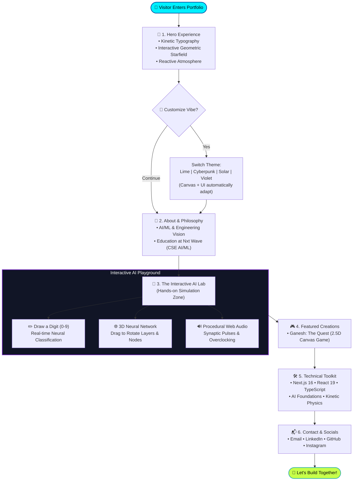
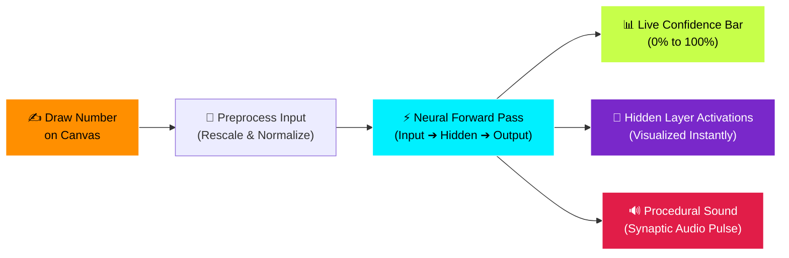
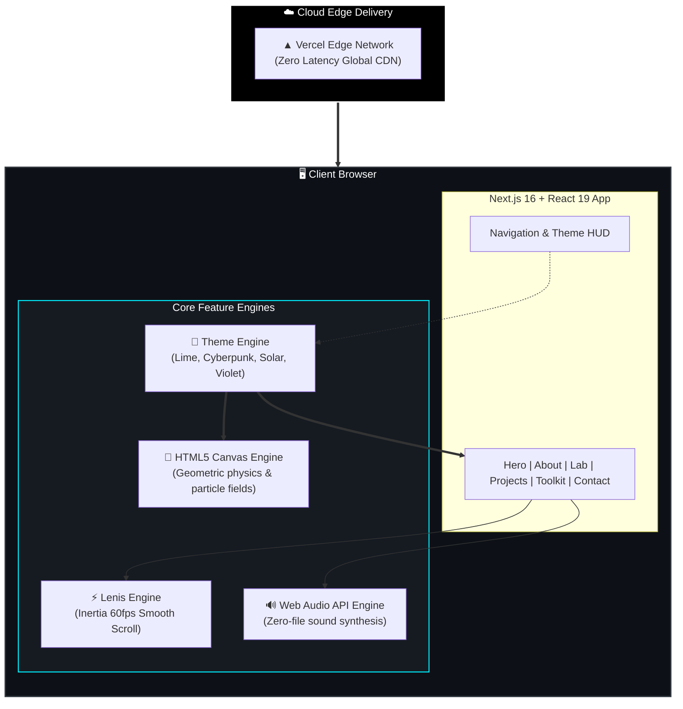

<div align="center">

# ⚡ Nikhil Sai Reddy — Interactive Portfolio
### *Where Artificial Intelligence Meets Immersive Web Experience*

[](https://nikhil-portfolio-vibex1.vercel.app)
[](https://github.com/nikhilsaireddyi/Nikhil)

<br/>

[](https://nextjs.org/)
[](https://react.dev/)
[](https://www.typescriptlang.org/)
[](https://tailwindcss.com/)
[](https://developer.mozilla.org/en-US/docs/Web/API/Web_Audio_API)
[](https://nikhil-portfolio-vibex1.vercel.app)

<br/>

> **"A digital playground built to demonstrate modern web engineering, real-time AI simulations, and fluid cyberpunk aesthetics."**

---

</div>

## 💡 What is this project? (In Simple Words)

Most portfolios are just static resumes on a screen. **This project is different.**

It is an **interactive digital showcase** created by **Nikhil Sai Reddy** (AI/ML Developer & Frontend Engineer). Rather than just listing skills in bullet points, this site **lets visitors interact directly** with real-time neural network simulations, dynamic sound synthesis, customizable visual themes, and smooth physics.

---

## 🗺️ Visual Flowchart: How the Portfolio Works

Here is a bird's-eye view of how a visitor moves through the portfolio:



---

## 🧠 Interactive AI Lab: How the Digit Classifier Works

Inside the portfolio's **Lab section**, anyone can test an AI model directly inside the browser. No servers, no delays:



---

## ⚙️ Under-the-Hood: System Architecture

How all the technologies connect together seamlessly:



---

## 🌟 Key Sections Explained

| # | Section | What Visitors See & Experience |
| :-: | :--- | :--- |
| **1** | **Hero & Cyber Sky** | A dynamic animated HUD with role cycling and a particle constellation canvas that responds to theme changes. |
| **2** | **About & Vision** | Nikhil's journey as an aspiring AI Engineer from **Vizag, India**, pursuing CSE (AI/ML) at **Nxt Wave**. |
| **3** | **Interactive Lab** | A hands-on science room with a **Neural Digit Classifier**, **3D Network visualizer**, and **hardware overclock sound engine**. |
| **4** | **Featured Projects** | Showcases **Ganesh: The Quest** — an original 2.5D festival adventure game with custom physics, procedural music, and parallax art. |
| **5** | **Toolkit & Skills** | Organized breakdown of frontend technologies, kinetic engines, and artificial intelligence focus areas. |
| **6** | **Contact Terminal** | Direct links to collaborate via email, LinkedIn, GitHub, and Instagram. |

---

## 🎨 Reactive Theme Engine

Visitors can toggle between **4 custom aesthetics** with one click in the navbar. Every single element adapts dynamically:

```
[ Lime Spark ]      ➔ High-energy Neon Lime & Deep Carbon (#C7FF4A)
[ Cyberpunk 2077 ]  ➔ Electric Cyan & Synthwave Magenta (#00F0FF)
[ Solar Flare ]     ➔ Solar Amber & Warm Ember Glow (#FF8F00)
[ Deep Violet ]     ➔ Midnight Violet & Dimensional Purple (#7928CA)
```

---

## 🚀 Quick Start (Run Locally on Your Machine)

Want to explore the code or run this on your computer? Follow these 4 easy steps:

### 1. Clone the project
```bash
git clone https://github.com/nikhilsaireddyi/Nikhil.git
cd Nikhil
```

### 2. Install dependencies
```bash
npm install
```

### 3. Run the development server
```bash
npm run dev
```

### 4. Open in your browser
Navigate to **`http://localhost:3000`** to experience the portfolio locally!

---

## 📁 Repository Directory Map

```
nikhil-portfolio/
│
├── 📂 src/
│   ├── 📂 app/              # Next.js 16 App Router (pages & global layout)
│   ├── 📂 components/       # All modular UI components
│   │   ├── 📂 layout/       # Navigation bar, Footer, Theme Switcher
│   │   ├── 📂 motion/       # HTML5 Canvas background & smooth scrolling
│   │   ├── 📂 sections/     # Hero, About, Lab, Projects, Toolkit, Contact
│   │   └── 📂 ui/           # Neural Classifier, 3D Network, Buttons
│   ├── 📂 data/             # Easily editable data (projects, skills, socials)
│   ├── 📂 hooks/            # Custom hooks (hover states, reduced motion)
│   ├── 📂 lib/              # Procedural Web Audio synthesizer
│   └── 📂 types/            # TypeScript data contracts & interfaces
│
├── 📂 public/               # Images, icons, and static assets
├── 📄 package.json          # Project dependencies & npm scripts
└── 📄 README.md             # You are here!
```

---

## 🌐 Live Deployments

* **Primary Link:** [https://nikhil-portfolio-vibex1.vercel.app](https://nikhil-portfolio-vibex1.vercel.app)
* **CDN Mirror:** [https://nikhil-portfolio-gamma-orcin.vercel.app](https://nikhil-portfolio-gamma-orcin.vercel.app)

---

## 📬 Let's Connect!

<div align="center">

**Nikhil Sai Reddy**  
*AI/ML Developer & Frontend Engineer • Vizag, India*

<br/>

[](mailto:nikhilsaireddyi@gmail.com)
[](https://www.linkedin.com/in/nikhil-sai-reddy-induri-0ab948432)
[](https://github.com/nikhilsaireddyi)
[](https://www.instagram.com/_nikhilsai08_)

<br/>

<sub>⭐ If you enjoyed exploring this portfolio, don't forget to star the repository!</sub>

</div>
